Desenvolvedor Full Stack e estudante de Engenharia da Computação na UERGS, em Guaíba (RS). Trabalho em produtos que rodam em produção: CRM B2B, plataforma de proteção social e P&D de máquinas para a indústria eletrônica.

  

### Onde estou trabalhando

- **Conecta Indústria Eletroeletrônica:** P&D de máquinas industriais, inspeção PTH/SMT, visão computacional e sistemas internos
- **Nidus Software:** Sistema de proteção social com RBAC multi-perfil, modelagem de dados e foco em LGPD

### Projetos principais

| Projeto | O que é | Stack |
|---|---|---|
| [**ALt.nexo**](https://github.com/Kauaritter13/alt-nexo) | IDE visual orientada a agentes: canvas infinito com instâncias reais do Claude Code | TypeScript · React · Electron · Node.js |
| **Ankora CRM** (privado) | CRM B2B para venda de chicotes elétricos e projetos de eletrônica, com web e app mobile | React · Express · Prisma · Flutter |
| **Four Imóveis** · [ao vivo](https://site-four.vercel.app) | Site imobiliário com busca, mapa, captação de leads e painel administrativo | Next.js · Drizzle · PostgreSQL |
| **Pedal Sustentável** · [ao vivo](https://pedalars.org/) | Empréstimo gratuito de bicicletas compartilhadas em Guaíba (RS) | Web · Geolocalização |

### Projetos de resenha

- [**Pixel Resenha**](https://github.com/Kauaritter13/pixelresenha) · [jogar](https://pixelresenha.vercel.app): joguinho multiplayer em pixel art, com chat de voz
- [**A Gente Tenta**](https://github.com/Kauaritter13/v0-a-gente-tenta) · [abrir](https://v0-a-gente-tenta.vercel.app): organiza resenha com os amigos, com convite por link e confirmação de presença
- [**Uergs Check**](https://github.com/Kauaritter13/Uergs-Check): acompanha matérias e créditos do curso na UERGS

### Ferramentas

### Atividade

<picture>
  <source media="(prefers-color-scheme: dark)" srcset="https://raw.githubusercontent.com/Kauaritter13/Kauaritter13/output/snake-dark.svg" />
  
</picture>

Boa parte do meu trabalho fica em repositórios privados de clientes e empresas.
